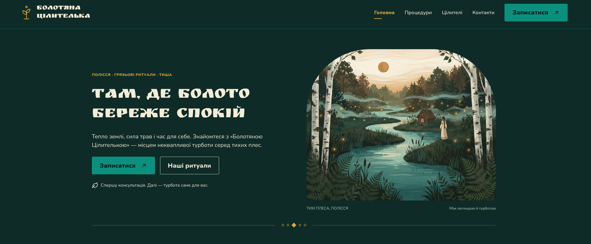

<p align="center">
  
</p>

<h1 align="center">Болотяна Цілителька</h1>

<p align="center">
  <em>Там, де болото береже спокій — вебсайт грязелікарні на Поліссі</em>
</p>

<p align="center">
  
  
  
  
  
  
</p>

<p align="center">
  <a href="https://rvdxse.github.io/mud_spa/">🌐 Демо</a> ·
  <a href="#-швидкий-старт">🚀 Швидкий старт</a> ·
  <a href="#-структура-проєкту">📂 Структура</a> ·
  <a href="#%EF%B8%8F-%D0%B4%D0%BE%D1%80%D0%BE%D0%B6%D0%BD%D1%8F-%D0%BA%D0%B0%D1%80%D1%82%D0%B0">🗺️ Дорожня карта</a>
</p>

---



## 📖 Про проєкт

**Болотяна Цілителька** — ілюстративний вебсайт вигаданої клініки грязьових ритуалів, натхненої слов'янською міфологією та природою Полісся. Сайт дозволяє відвідувачам ознайомитися з процедурами, познайомитися з цілителями та залишити запит на візит.

Проєкт побудований як статичний сайт без фреймворків і збірників — чистий HTML, CSS та JavaScript, розгорнутий на GitHub Pages.

### ✨ Ключові можливості

- 🏠 **Головна сторінка** — атмосферний лендінг із hero-секцією, описом підходу клініки, каталогом процедур та відгуками гостей
- 💆 **Каталог процедур** — 5 ритуалів (грязьові ванни, обгортання, торф'яні аплікації, фіточай, масаж) з цінами, тривалістю та інтерактивними фільтрами за категоріями
- 🧙 **Сторінка цілителів** — розбір чотирьох персонажів-опікунів (Берегиня, Мавка, Болотяник, Вогник) з авторською легендою
- 📋 **Форма запису** — клієнтська валідація (ім'я, телефон +380, дата, згода на обробку даних), вибір процедури та дати
- 🗺️ **Контакти та карта** — графік роботи, художня схема маршруту, контактні дані
- 🎨 **UI/UX** — адаптивний дизайн, мобільне меню (hamburger), scroll-анімації через `IntersectionObserver`, паралакс ефекти, орнаментальні розділювачі
- ♿ **Доступність** — ARIA-атрибути, `aria-current`, `aria-label`, семантична розмітка, підтримка `prefers-reduced-motion`

---

## 🛠 Технологічний стек

| Категорія         | Технологія | Призначення                                                                                       |
| -------------------------- | -------------------- | ------------------------------------------------------------------------------------------------------------ |
| **Розмітка** | HTML5                | Семантична структура з BEM-іменуванням CSS-класів                       |
| **Стилі**       | CSS3                 | Кастомні властивості, Grid, Flexbox, анімації та медіа-запити        |
| **Скрипти**   | Vanilla JavaScript   | Навігація, фільтри, валідація форми, scroll-анімації, паралакс |
| **Шрифти**     | Google Fonts         | `Nunito` (основний), `Ruslan Display` (декоративний)                                 |
| **Іконки**     | Inline SVG sprites   | Набір із 16+ SVG-символів у `<defs>`                                                       |
| **Хостинг**   | GitHub Pages         | Статичний деплой з гілки репозиторію                                         |

---

## 📂 Структура проєкту

```
bolotiana/
├── index.html              # Головна сторінка
├── procedures.html         # Каталог процедур із фільтрами
├── healers.html            # Сторінка цілителів та легенда
├── contacts.html           # Контакти, форма запису, карта
├── css/
│   └── style.css           # Єдиний файл стилів (~1800 рядків)
├── js/
│   └── main.js             # Логіка: навігація, фільтри, валідація, анімації
├── assets/
│   ├── logo.svg            # SVG-логотип бренду
│   ├── hero-landscape.png  # Hero-зображення головної сторінки
│   ├── herbarium.png       # Ілюстрація гербарію (секція «Про нас»)
│   ├── legend.png          # Ілюстрація до легенди
│   ├── map.png             # Художня схема маршруту
│   ├── healer-{1..4}.png   # Портрети 4-х цілителів
│   ├── proc-baths.png      # Фото: грязьові ванни
│   ├── proc-wrap.png       # Фото: обгортання
│   ├── proc-peat.png       # Фото: торф'яні аплікації
│   ├── proc-tea.png        # Фото: фіточай
│   └── proc-massage.png    # Фото: масаж
└── icon/
    └── favicon.ico         # Фавікон сайту
```

---

## 🚀 Швидкий старт

### Передумови

Для локальної розробки достатньо будь-якого HTTP-сервера. Немає залежностей від Node.js, Python чи Docker — це чистий статичний сайт.

Знадобиться:

- [Git](https://git-scm.com/) — для клонування репозиторію
- Будь-який локальний сервер (або розширення браузера типу [Live Server](https://marketplace.visualstudio.com/items?itemName=ritwickdey.LiveServer))

### Встановлення

```bash
# 1. Клонування репозиторію
git clone https://github.com/rvdxse/mud_spa.git

# 2. Перехід у директорію проєкту
cd mud_spa
```

### Запуск

Оберіть будь-який зручний спосіб запустити локальний сервер:

<details>
<summary><strong>Python (вбудований сервер)</strong></summary>

```bash
# Python 3
python3 -m http.server 8000

# Python 2
python -m SimpleHTTPServer 8000
```

Відкрийте у браузері: `http://localhost:8000`

</details>

<details>
<summary><strong>Node.js (npx serve)</strong></summary>

```bash
npx serve .
```

</details>

<details>
<summary><strong>VS Code — Live Server</strong></summary>

1. Встановіть розширення [Live Server](https://marketplace.visualstudio.com/items?itemName=ritwickdey.LiveServer)
2. Відкрийте `index.html`
3. Натисніть **Go Live** у нижній панелі

</details>

> **Примітка:** Відкриття `index.html` напряму через `file://` може обмежити роботу деяких функцій (шрифти Google Fonts потребують мережевого з'єднання).

### Деплой на GitHub Pages

Сайт автоматично розгортається на GitHub Pages із кореневої директорії репозиторію. Для власного деплою:

1. Форкніть репозиторій
2. Перейдіть у **Settings → Pages**
3. Оберіть гілку `main` (або `master`) та кореневу директорію `/`
4. Збережіть — сайт буде доступний за адресою `https://<username>.github.io/mud_spa/`

---

## 🗺️ Дорожня карта

- [X] Адаптивний багатосторінковий макет (Головна, Процедури, Цілителі, Контакти)
- [X] Інтерактивні фільтри процедур за категоріями (грязьові, трав'яні, для тіла)
- [X] Форма запису з клієнтською валідацією
- [X] Scroll-анімації та паралакс (з урахуванням `prefers-reduced-motion`)
- [X] Мобільна навігація (hamburger menu)
- [X] SVG-іконки через inline sprite
- [X] Деплой на GitHub Pages
- [ ] Підключення бекенду для реальної обробки заявок
- [ ] Багатомовність (UA / EN)
- [ ] SEO-оптимізація: Open Graph, структуровані дані (Schema.org)
- [ ] Оптимізація зображень: WebP/AVIF з `<picture>`, lazy loading placeholder
- [ ] Система відгуків із модерацією
- [ ] Інтеграція з Google Calendar для онлайн-запису

---

## 🤝 Внесок у проєкт

Контрибуції вітаються! Дотримуйтесь стандартного процесу:

```
1. Форкніть репозиторій
2. Створіть гілку для фічі:   git checkout -b feature/назва-фічі
3. Зробіть коміт:              git commit -m "feat: опис змін"
4. Відправте гілку:            git push origin feature/назва-фічі
5. Відкрийте Pull Request
```

### Правила

- Дотримуйтесь існуючого стилю коду та BEM-іменування CSS-класів
- Перевіряйте відображення на мобільних пристроях
- Не додавайте зовнішні залежності без обговорення в Issue

---

## 👥 Автори

<table>
  <tr>
    <td align="center"><a href="https://github.com/rvdxse"><br /><sub><b>rvdxse</b></sub></a></td>
    <td align="center"><a href="https://github.com/Valad42"><br /><sub><b>Valad42</b></sub></a></td>
    <td align="center"><a href="https://github.com/nazarmlnk"><br /><sub><b>nazarmlnk</b></sub></a></td>
    <td align="center"><a href="https://github.com/korzhanuyk"><br /><sub><b>korzhanuyk</b></sub></a></td>
  </tr>
</table>

---

## 📄 Ліцензія

© 2026 **Sobaky_Dicky**. Розповсюджується за ліцензією **MIT**. Деталі — у файлі [`LICENSE`](./LICENSE).
